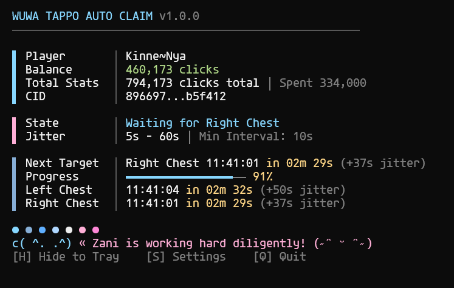

# Wuwa Tappo Auto Claim

  

[Tiếng Việt](#tiếng-việt) | [English](#english)

---

## Tiếng Việt

Tool tự động nhận rương cho **Wuwa Tappo** trên Windows. Chạy trong terminal, có thể thu xuống khay hệ thống.

### Tính năng
- Tự lấy Token / CID từ cookies WebView2 hoặc bộ nhớ của Wuwa Tappo.
- Tự tìm game qua tiến trình đang chạy, Registry và các ổ đĩa.
- Có độ trễ ngẫu nhiên sau khi rương xuất hiện và khoảng cách tối thiểu giữa 2 lần mở (`interval`) để tránh bị phát hiện.
- Đổi cài đặt ngay khi đang chạy, không cần tắt app.

### Cách dùng
Cài thư viện (nếu chạy bằng mã nguồn):

    pip install -r requirements.txt

Chạy bằng `run.bat` (dùng file `.exe` nếu có, không thì chạy Python), hoặc:

    python app.py

Một số tham số:

    python app.py --status
    python app.py --min-delay 5 --max-delay 30 --interval 15
    python app.py --tray

- `--status`: xem thông tin tài khoản rồi thoát
- `--min-delay`, `--max-delay`, `--interval`: chỉnh độ trễ (giây)
- `--tray`: khởi động ẩn dưới khay hệ thống

Phím tắt trong terminal: `H` thu xuống khay, `S` mở menu cài đặt, `Q` thoát.

Muốn đóng gói thành `.exe` thì chạy `build.bat`, file tạo ra là `WuwaTappoAutoClaim.exe`.

---

## English

Auto-claim tool for **Wuwa Tappo** on Windows. Runs in the terminal and can minimize to the system tray.

### Features
- Grabs Token / CID from WebView2 cookies or the game's memory.
- Finds the game through running processes, the registry and all drives.
- Random delay after a chest spawns and a minimum interval between claims (`interval`) to avoid detection.
- Change settings while it's running, no restart needed.

### Usage
Install dependencies (if running from source):

    pip install -r requirements.txt

Run with `run.bat` (uses the `.exe` if it exists, otherwise Python), or:

    python app.py

Some arguments:

    python app.py --status
    python app.py --min-delay 5 --max-delay 30 --interval 15
    python app.py --tray

- `--status`: show account info and exit
- `--min-delay`, `--max-delay`, `--interval`: adjust delays (seconds)
- `--tray`: start hidden in the system tray

Hotkeys in the terminal: `H` to hide to tray, `S` for the settings menu, `Q` to quit.

To build a standalone `.exe`, run `build.bat`. The output is `WuwaTappoAutoClaim.exe`.

---

**License:** MIT
